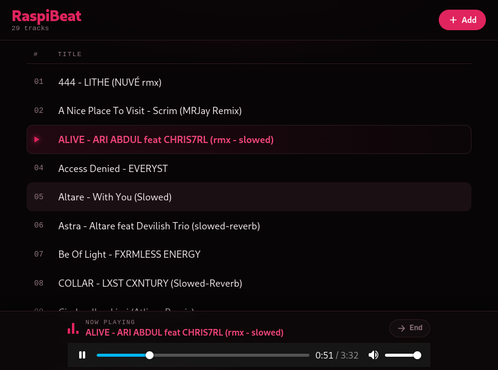

<div align="center">
   
</div>

<br>

A lightweight, self-hosted local music server built with **Go** and **Vanilla JavaScript**, specifically engineered to run with minimal overhead on low-power hardware like the Raspberry Pi Zero W.

RaspiBeat features an intentionally minimalist interface designed exclusively for local network use. It strictly provides what is necessary: a clean track listing, lightweight audio playback, and a single button to add new songs to the server. By keeping the design bare-bones and avoiding frontend frameworks, resource usage on the Raspberry Pi is kept as low as possible.

<br>

## Features

- **Minimalist & Resource-Efficient:** Purpose-built for local use with zero framework bloat. The simple layout keeps CPU and RAM usage on the Raspberry Pi strictly to a minimum.

- **Web Upload (`+ Add` Button):** Quickly upload new audio files directly to the server from any device on your local network.

- **Local Library Scanning:** Automatically indexes your audio tracks (`.mp3`, `.flac`, `.m4a`, `.ogg`) stored on the server.

- **HTTP Audio Streaming:** Built with Go's `http.ServeFile` using HTTP Range Requests. Allows instant seeking (skipping forward/backward) without excessive buffering or memory spikes.

- **Auto-Play Next:** Automatically starts playing the next song in your library when the current track finishes.

- **Media Session API:** Integrates directly with your device's native media controls (lock screen, control center, and hardware play/pause keys).

- **Zero Dependencies (Frontend):** Written in pure HTML5, CSS3, and Vanilla JavaScript—no npm, React, Vue, or build steps required.

<br>

## Tech Stack

- **Backend:** Go (Standard Library only)
- **Frontend:** HTML5, CSS3, Vanilla JavaScript
- **Streaming:** `http.ServeFile` (native Range Request support)

<br>

## Getting Started

### Prerequisites

- [Go](https://go.dev/doc/install) (version 1.25 or higher)
- A local network (your device and the Raspberry Pi must be connected to the same Wi-Fi/LAN).

### Installation, Building & Running

1. **Clone the repository:**
   ```bash
   git clone https://github.com/olivercalazans/raspibeat.git
   cd raspibeat
   ```

2. **Compile the binary:**
   Build the executable file:
   ```bash
   go build -o raspibeat .
   ```

3. **Run the server:**
   Execute the compiled binary:
   ```bash
   ./raspibeat
   ```

4. **Access the interface:**
   Open your browser and navigate to:
   - On the host machine: `http://localhost:60888`
   - From any phone/PC on the network: `http://<IP_ADDRESS_OF_YOUR_PI>:60888`

<br>

## API Endpoints

- `GET /api/library`: Returns a JSON array of all available tracks.
- `GET /stream?file=<filename>`: Streams the requested audio file using HTTP Range Requests.
- `POST /upload`: Handles track uploads triggered by the `+ Add` button.

<br>

## License

This project is open-source and available under the [Apache-2.0 License](LICENSE).
